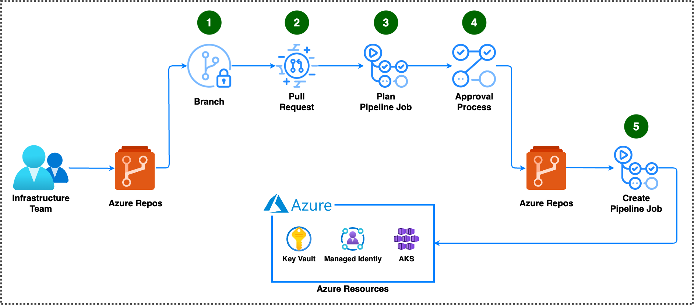

# Bicep deploy for Azure DevOps

An Azure Pipeline that plans Bicep in the pull request, posts the plan as a comment in Azure Repos, and deploys after the environment approval. It runs the same scripts as the GitHub actions, so the comments and the safety checks are the same.

## Files

| File | Use it for |
|---|---|
| [`ms.azure.deploy.yml`](./ms.azure.deploy.yml) | **Start here.** A complete single-environment pipeline. Every step is inline, so no template repository is needed. Deployment stacks and the cost estimate are turned on. |
| [`templates/plan-stage.yml`](./templates/plan-stage.yml), [`templates/deploy-stage.yml`](./templates/deploy-stage.yml) | Reusable plan and deploy stages for several environments. See the [multi-environment example](../docs/examples/azure-devops/multi-environment.yml). |

## Get started

1. Follow [Azure DevOps setup](../docs/setup-azure-devops.md): an environment with approvals, a service connection, an Azure role, the pull request permission, the pipeline and the branch policy.
2. Set the variables. Every variable is described in the [configuration reference](../docs/configuration.md).
3. Open a pull request.

## Stage template parameters

| Parameter | Template | Default | Meaning |
|---|---|---|---|
| `serviceConnection` | both | (required) | The Azure Resource Manager service connection. |
| `stageName`, `displayName` | both | `Plan` / `Deploy` | The stage name and label. Each environment needs unique names. |
| `dependsOn` | both | plan: `[]`; deploy: `[Plan]` | Stage dependencies. |
| `condition` | both | `succeeded()` | The stage condition. |
| `variables` | both | `{}` | Stage variables (a map). They override pipeline variables, so use them for per-environment values. |
| `environmentName` | deploy | `Deploy` | The Azure DevOps environment whose approval check gates the deployment. |
| `planStageName`, `planJobName` | deploy | `Plan`, `plan` | Where the deploy stage reads the plan's outputs: providers, Bicep version, stack settings. |

## More

- [How it works](../docs/how-it-works.md)
- [Configuration reference](../docs/configuration.md)
- [Troubleshooting](../docs/troubleshooting.md)
- [Overview and value](../README.md)

## License

The code and documentation in this project are released under the [BSD 3-Clause License](../LICENSE).
