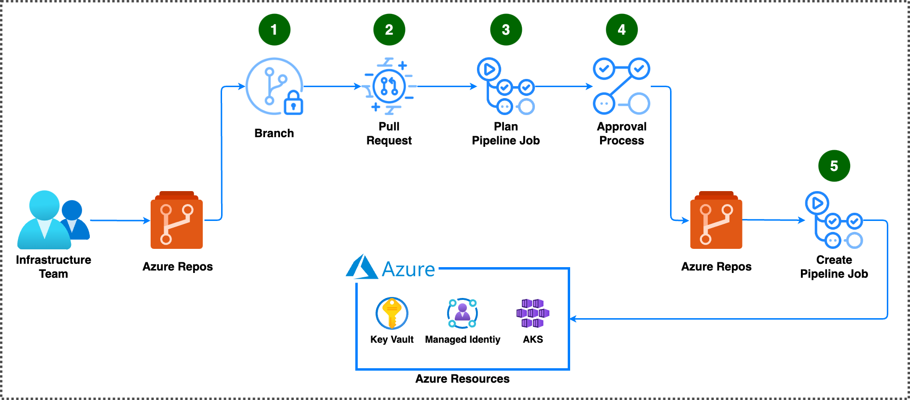

# Bicep deploy

A [pipeline](ms.azure.deploy.yml) to plan and deploy Azure infrastructure.

## Overview



1. The user creates a new branch, then commits and push the code.
1. The user creates a pull request.
1. The pipeline is automatically triggered and starts the [plan job](#plan-job).
1. If the plan job was successful, the pipeline will wait for a [required reviewer](#get-started) to approve the [deploy job](#deploy-job).
1. When a reviewer has approved, the pipeline starts the [deploy job](#deploy-job) to deploy the code.

## Get started

To use the pipeline, several prerequisite steps are required:

1. Install the [PSRule](https://marketplace.visualstudio.com/items?itemName=bewhite.ps-rule) Azure DevOps extension.

1. Create an [environment](https://learn.microsoft.com/en-us/azure/devops/pipelines/process/environments?view=azure-devops).

1. To prevent unapproved deployments, add the [**"Approvals"**](https://learn.microsoft.com/en-us/azure/devops/pipelines/process/approvals?view=azure-devops&tabs=check-pass#approvals) check to the environment.

1. Create a [Azure Resource Manager workload identity service connection](https://learn.microsoft.com/en-us/azure/devops/pipelines/release/configure-workload-identity?view=azure-devops).

1. Assign [Azure roles](https://learn.microsoft.com/en-us/azure/role-based-access-control/role-assignments-steps) to the application so it can deploy Azure infrastructure. For example, give it the **"Owner"** role on the target Azure subscription.

1. [If needed, create a repo](https://learn.microsoft.com/en-us/azure/devops/repos/git/create-new-repo?view=azure-devops#create-a-repo-using-the-web-portal).

1. In the [repo settings](https://learn.microsoft.com/en-us/azure/devops/repos/git/set-git-repository-permissions?view=azure-devops#open-security-for-a-repository), ensure the [build service](https://learn.microsoft.com/en-us/azure/devops/pipelines/process/access-tokens?view=azure-devops&tabs=yaml#manage-build-service-account-permissions) has **"Contribute to pull requests"** permission.

1. Add the [ms.azure.deploy.yml](./ms.azure.deploy.yml) to a repo folder, e.g. **".pipelines"**.

1. Customize the variable values in the **"ms.azure.deploy.yml"** file and commit the changes.

1. If needed, add [bicep](https://learn.microsoft.com/en-us/azure/azure-resource-manager/bicep/) code to the repo.

1. Add a [ps-rule.yaml](./../ps-rule.yaml) file to the same folder as the main bicep/template file or in the repository root.

1. Go to the Azure DevOps **Pipelines** page. Then choose the action to create a **New pipeline**.

1. Select **Azure Repos Git** as the location of the source code.

1. When the list of repositories appears, select the repository.

1. Select **Existing Azure Pipelines YAML file** and choose the YAML file: **"/.pipelines/ms.azure.deploy.yml"**.

1. Save the pipeline without running it.

1. Configure [branch policies](https://learn.microsoft.com/en-us/azure/devops/repos/git/branch-policies?view=azure-devops&tabs=browser#configure-branch-policies) for the default/main branch.

1. Add a [build validation branch policy](https://learn.microsoft.com/en-us/azure/devops/repos/git/branch-policies?view=azure-devops&tabs=browser#build-validation).

## Pipeline

The pipeline is designed to run when a pull request is created or updated.

The jobs in this pipeline has been tested on a [standard Microsoft-hosted agent](https://learn.microsoft.com/en-us/azure/devops/pipelines/agents/hosted?view=azure-devops&tabs=yaml#software) with YAML VM Image Label **"ubuntu-22.04"**.

The following tools are used:

- [Azure CLI](https://learn.microsoft.com/en-us/cli/azure/)
  - [az bicep build](https://learn.microsoft.com/en-us/cli/azure/bicep?view=azure-cli-latest#az-bicep-build)
  - [az bicep build-params](https://learn.microsoft.com/en-us/cli/azure/bicep?view=azure-cli-latest#az-bicep-build-params)
  - [az provider register](https://learn.microsoft.com/en-us/cli/azure/provider?view=azure-cli-latest#az-provider-register)
  - [az deployment {SCOPE} create](https://learn.microsoft.com/en-us/cli/azure/deployment/sub?view=azure-cli-latest#az-deployment-sub-create)
  - [az deployment {SCOPE} validate](https://learn.microsoft.com/en-us/cli/azure/deployment/sub?view=azure-cli-latest#az-deployment-sub-validate)
  - [az deployment {SCOPE} what-if](https://learn.microsoft.com/en-us/cli/azure/deployment/sub?view=azure-cli-latest#az-deployment-sub-what-if)
- [Azure Cost Estimator](https://github.com/TheCloudTheory/arm-estimator)
- [curl](https://curl.se/)
- Azure Pipelines task:
  - [AzureCLI@2](https://learn.microsoft.com/en-us/azure/devops/pipelines/tasks/reference/azure-cli-v2?view=azure-pipelines)
  - [checkout](https://learn.microsoft.com/en-us/azure/devops/pipelines/yaml-schema/steps-checkout?view=azure-pipelines)
  - [ps-rule-assert](https://github.com/microsoft/PSRule-pipelines/blob/main/docs/tasks.md#ps-rule-assert)
  - [publish](https://learn.microsoft.com/en-us/azure/devops/pipelines/yaml-schema/steps-publish?view=azure-pipelines)
- [GNU bash](https://www.gnu.org/software/bash/)
- [GNU bc](https://www.gnu.org/software/bc/)
- [GNU core utilities](https://www.gnu.org/software/coreutils/coreutils.html)
- [GNU find utilities](https://www.gnu.org/software/findutils/)
- [jq](https://jqlang.github.io/jq/)
- [sed](https://www.gnu.org/software/sed/)
- [unzip](https://infozip.sourceforge.net/)

### Plan job

The plan job will build and test the code. If no issues are found in the code, a [what-if](https://docs.microsoft.com/cli/azure/deployment/sub#az-deployment-sub-what-if) report is generated.

The PSRule steps will only run if **"rule_option"** is specified and points to a file that exist.

**Plan job steps:**

1. **Tool Installation** - Downloads and installs required CLI tools (Bicep, PSRule modules)
2. **Bicep Build** - Compiles `.bicep` files to ARM JSON templates
3. **Bicep Build Params** - Compiles `.bicepparam` files to ARM parameter JSON
4. **Deployment Validation** - Validates the deployment without making changes
5. **What-If Analysis** - Generates a report showing what changes would be deployed
6. **PSRule Analysis** - Runs policy and best practice checks (if configured)
7. **Cost Estimation** - Estimates deployment costs using Azure Cost Estimator (if configured)
8. **Debug Information** - Collects diagnostic information (on failure or verbose logging)
9. **Pipeline Summary** - Displays a formatted summary of execution results
10. **PR Comment** - Posts results as a comment on the pull request (for PR builds)
11. **Upload Logs** - Publishes all logs and reports as pipeline artifacts

For more information about PSRule configuration, see:

- [Sample ps-rule.yaml](../ps-rule.yaml)
- [Configuring options](https://azure.github.io/PSRule.Rules.Azure/setup/configuring-options/)
- [Configuring rule defaults](https://azure.github.io/PSRule.Rules.Azure/setup/configuring-rules/)
- [Available Options](https://microsoft.github.io/PSRule/v2/concepts/PSRule/en-US/about_PSRule_Options/)
- [Available Rules by resource type](https://azure.github.io/PSRule.Rules.Azure/en/rules/resource/)

### Deploy job

The deploy job will only run when the plan job was successful.

It targets a specific [environment](#get-started).

If the environment is configured with **Approvers**, the job will require manual approval.

**Deploy job steps:**

1. **Tool Installation** - Downloads required CLI tools
2. **Provider Registration** - Registers Azure resource providers needed by the deployment
3. **Infrastructure Deployment** - Executes the actual deployment to Azure
4. **Debug Information** - Collects diagnostic information (on failure or verbose logging)
5. **Pipeline Summary** - Displays a formatted summary of deployment results
6. **PR Comment** - Posts deployment results as a comment (for PR builds)
7. **Upload Logs** - Publishes deployment logs as pipeline artifacts

#### Deployment stacks (opt-in)

Set the **DEPLOYMENT_MODE** variable to `stack` to plan and deploy the template as an [Azure deployment stack](https://learn.microsoft.com/azure/azure-resource-manager/bicep/deployment-stacks) instead of a standard deployment. The default is `deployment`, and nothing changes unless you opt in.

- **Plan.** The what-if runs as a deployment stack what-if (`az stack-whatif`). The PR comment starts with a summary (to create, modify, delete, detach, unsupported, unchanged), lists any resource the stack would delete or detach, and then shows the full change set.
- **Deploy.** The template is deployed with `az stack ... create`.
- **Unmanaged resources.** **STACK_ACTION_ON_UNMANAGE** sets what happens to a resource that is removed from the template. The default `detachAll` never deletes anything: the resource is only released from the stack. `deleteResources` and `deleteAll` delete it.
- **Delete gate.** When the stack would delete a resource, the plan **fails** unless that resource ID is listed in the JSON array file named by **STACK_APPROVED_DELETES**, so every delete is approved in a reviewed commit. With a delete mode, the plan also fails when Azure reports the what-if result as not deterministic (some resource names are only known at deploy time), because then not every delete can be shown.
- **Deploy exactly what was planned.** The plan records its mode and stack settings, and the deploy stage reads them (`what_if.stack_settings`). A deployment with different settings, for example `deleteAll` after a plan with `detachAll`, fails and asks for a new plan. With a delete mode, the deployment also runs the delete gate again on the current state just before deploying, because the plan can be old. The gate also fails when the what-if result is missing or incomplete.
- **Deny settings.** **STACK_DENY_SETTINGS_MODE** (`none` by default, or `denyDelete` / `denyWriteAndDelete`).
- **Stack name.** **STACK_NAME**, by default the repository name. The stack is created at the deployment scope (resource group, subscription or management group).
- **Adopting existing resources.** The first stack plan for resources that a standard deployment created shows them as adopted (`notManaged` => `managed`). That plan, and later ones, can also show property differences that Azure set itself, such as provider defaults or tags that a policy rewrites on every deployment. Azure's noise reduction for stack what-if is meant to filter many of these, but it does not remove all of them, so read them as possible noise. A template whose resource names are only known at deploy time also makes the what-if result non-deterministic: those resources can be listed as detached (or, with a delete mode, deleted) even though the deployment keeps them, which is why delete modes fail the plan in that case.
- **Fallback.** Templates that use Bicep extensions, and tenant-scope deployments, are not supported by deployment stacks. They are deployed as a standard deployment, with a warning.
- Requires an Azure CLI with the `stack-whatif` command.

#### Bicep CLI version

The Bicep CLI is not pinned. Every plan installs and uses the **latest** Bicep release, so new Bicep features are available as soon as they ship. The first step that compiles picks the version and every later step of the plan uses the same one, so the build, PSRule, the cost estimate and the what-if all see the same compiled template. If the latest release cannot be installed, the plan stops rather than continue with an older compiler. The version is shown in the plan logs and in the PR comment.

The deployment then uses **the same version the plan used**, so it compiles exactly the template that the what-if showed, even if a newer Bicep was released while the deployment waited for approval. This works like Atlantis, which applies a Terraform plan only with the Terraform version that made it. If that version cannot be installed, the deployment stops with a message to run the plan again, because the reviewed what-if no longer describes what would be deployed.

A new Bicep release can change the compiled output. When it does, the next plan shows that change in the what-if (and in the Bicep snapshot, if one is used) for review like any other change.

In the Azure DevOps templates this is automatic: the deploy stage reads the plan stage's version (`what_if.bicep_version`).

### Troubleshooting

**Debug Information**

The pipeline automatically collects debug information when:
- A step fails
- `IN_SEVERITY` is set to `VERBOSE` or `DEBUG`

Debug information includes:
- Pipeline context (build ID, branch, commit)
- Infrastructure configuration (template, scope, location)
- Tool versions (Bicep, Azure CLI, PSRule)
- File system contents
- Azure account information
- System resources (disk, memory)
- Environment variables (filtered for security)

**Pipeline Summary**

Each stage ends with a formatted summary showing:
- Overall execution status
- Infrastructure configuration
- Completed steps with status indicators
- Available artifacts
- Build and branch information

**Viewing Logs**

All execution logs and reports are published as pipeline artifacts:
- `plan_logs_$(ARTIFACT_IDENTIFIER)_$(System.JobAttempt)` - Plan stage outputs (what-if, PSRule, cost estimate)
- `deploy_logs_$(ARTIFACT_IDENTIFIER)_$(System.JobAttempt)` - Deploy stage outputs (deployment results)

Access artifacts through: **Pipeline Run → Summary → Published Artifacts**

**Note:** Azure DevOps requires artifact names to be unique within a build. `ARTIFACT_IDENTIFIER` separates artifacts from different stages or environments in the same run, and `System.JobAttempt` (1 on the first run, incremented on each re-run of the job) keeps a re-run from colliding with the attempt before it, so each attempt keeps its own logs. The upload steps use `continueOnError: true`: log upload is diagnostic and never fails the stage.

**Cross-Subscription Permissions**

When deploying infrastructure that references resources in other Azure subscriptions, the service principal requires additional RBAC permissions:

**Common scenarios:**
- **Private DNS Zones** - If creating private endpoints with DNS integration in a centralized DNS subscription:
  - Grant `Private DNS Zone Contributor` role on the target private DNS zone
  - Required for `Microsoft.Network/privateDnsZones/join/action`

- **Central Log Analytics** - If configuring diagnostic settings to send logs to a centralized monitoring workspace:
  - Grant `Log Analytics Contributor` role on the target Log Analytics workspace
  - Required for `Microsoft.OperationalInsights/workspaces/sharedKeys/action`

**Example permission grant:**
```bash
# Grant Private DNS Zone Contributor
az role assignment create \
  --assignee-object-id <service-principal-object-id> \
  --assignee-principal-type ServicePrincipal \
  --role "Private DNS Zone Contributor" \
  --scope "/subscriptions/<subscription-id>/resourceGroups/<rg-name>/providers/Microsoft.Network/privateDnsZones/<zone-name>"

# Grant Log Analytics Contributor
az role assignment create \
  --assignee-object-id <service-principal-object-id> \
  --assignee-principal-type ServicePrincipal \
  --role "Log Analytics Contributor" \
  --scope "/subscriptions/<subscription-id>/resourceGroups/<rg-name>/providers/Microsoft.OperationalInsights/workspaces/<workspace-name>"
```

**Finding the service principal object ID:**
```bash
# Get the service connection's application ID from Azure DevOps
# Then query for the object ID:
az ad sp show --id <application-id> --query id -o tsv
```

### Variable Group

When using a variable group, make sure the pipeline has permissions to get the values.

Update the [pipeline](ms.azure.deploy.yml) and replace the `variables:` with section to only include the name of the variable group, for example:

```yaml
trigger: none
pr:
  autoCancel: true
  drafts: false

name: Azure Deploy

pool:
  vmImage: ubuntu-latest

variables:
  - group: PROD_GROUP

stages:
  - stage: Plan
```

### Variables

- **ARTIFACT_IDENTIFIER**: A unique identifier added to artifact name in case of multiple runs within one workflow.

- **COST_THRESHOLD**: Max acceptable estimated cost. Exceeding threshold causes plan to fail.

- **ENVIRONMENT**: Name of the [environment](#get-started) to use for the [deploy job](#deploy-job).

- **IN_CURRENCY**: Currency code to use for estimations. See allowed values at <https://github.com/TheCloudTheory/arm-estimator/wiki/Options#currency>

- **IN_LOCATION**: The Azure location to store the deployment metadata.

- **IN_MANAGEMENT_GROUP**: Management group to create deployment at for mg scope.

- **IN_PROVIDERS**: A comma separated list of Azure resource providers.

  The pipeline create job will try to register the specified providers in addition to the providers that is detected in code by deployment validate.

  Use the value **"disable"** to prevent the pipeline from trying to register Azure resource providers.

- **IN_RESOURCE_GROUP**: Resource group to create deployment at for group scope.

- **IN_TEMPLATE**: The template address. A path or URI to a file or a template spec resource id.

- **IN_TEMPLATE_PARAMS**: Deployment parameter values. Either a path, URI, JSON string, or `<KEY=VALUE>` pairs.

- **IN_SCOPE**: The deployment scope. Accepted: tenant, mg, sub, group.

- **IN_SEVERITY**: The log verbosity. Can be one of:

  - ERROR - Only show errors, suppressing warnings.
  - INFO - Standard log level.
  - VERBOSE - Increase logging verbosity.
  - DEBUG - Show all debug logs.

- **PSRULE_AZURE_RESOURCE_MODULE_NOWARN**: Suppresses a warning when the minimum version of Az.Resources module is not installed.

- **RULE_BASELINE**: The name of a PSRule baseline to use. For a list of baseline names for module PSRule.Rules.Azure see <https://azure.github.io/PSRule.Rules.Azure/en/baselines/Azure.All/>. When empty, PSRule uses `Azure.Default`, which picks up every new rule as soon as a new PSRule.Rules.Azure version is installed. To keep results stable, set a quarterly baseline such as `Azure.GA_2026_03` and move to a newer one when you are ready for the new rules. Older quarterly baselines still work but log an obsolete warning. A quarterly baseline ignores custom (local) rules unless `Rule.IncludeLocal: true` is set in the options file. To turn off a single rule instead, exclude it in the options file (`rule: { exclude: [Azure.VNET.PrivateSubnet] }`). See <https://azure.github.io/PSRule.Rules.Azure/working-with-baselines/>.

- **RULE_MODULES**: A comma separated list of modules to use for analysis. For a list of modules see <https://www.powershellgallery.com/packages?q=Tags%3A%22PSRule-rules%22>

- **RULE_OPTION**: The path to an options file. If empty, PSRule will be skipped.

- **DEPLOYMENT_MODE**: `deployment` (default) or `stack`. See [Deployment stacks (opt-in)](#deployment-stacks-opt-in).

- **STACK_ACTION_ON_UNMANAGE**: With `stack`: `detachAll` (default), `deleteResources` or `deleteAll`.

- **STACK_APPROVED_DELETES**: With `stack`: path to a JSON array of resource IDs the stack may delete.

- **STACK_DENY_SETTINGS_MODE**: With `stack`: `none` (default), `denyDelete` or `denyWriteAndDelete`.

- **STACK_NAME**: With `stack`: the stack name. Defaults to the repository name.

- **SERVICE_CONNECTION**: The Azure Resource Manager service connection name.

- **SUBSCRIPTION_ID**: The subscription ID in which to deploy the resources.

- **VERSION_ACE**: Azure Cost Estimator version. If empty, cost estimator will be skipped. See versions at <https://github.com/TheCloudTheory/arm-estimator/releases>. Version 1.6 cannot parse templates that Bicep compiles with `languageVersion` 2.0 (for example when user-defined types are used) and fails the step. Use 1.6.5 or later.

- **WAIT_SECONDS**: Seconds to wait between each provider status check.

- **WAIT_COUNT**: Times to check provider status before giving up.

- **WORKFLOW_VERSION**: The version of the bicep-action scripts to use. See <https://github.com/innofactororg/bicep-action/tags>.

## License

The code and documentation in this project are released under the [BSD 3-Clause License](../LICENSE).
