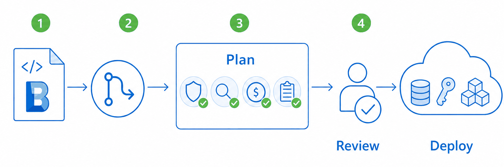
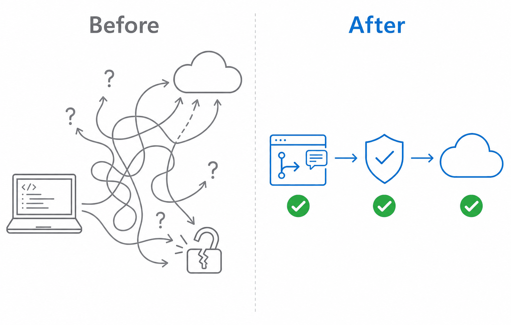
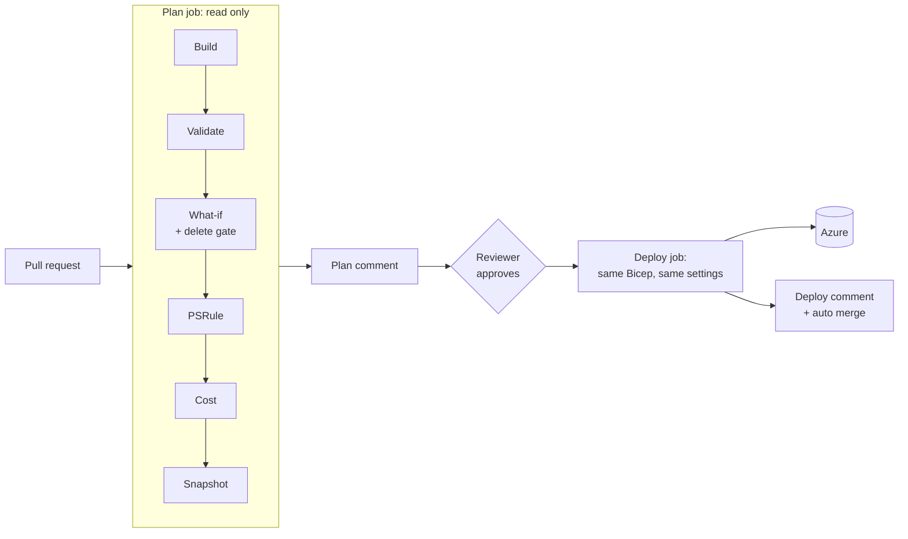
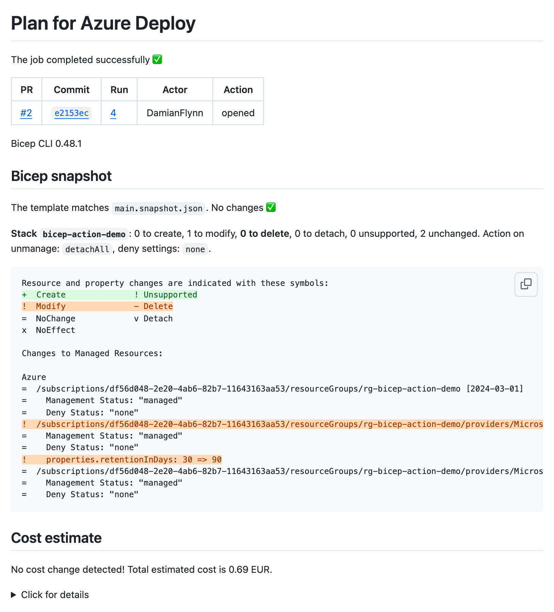

# Bicep deploy

**Plan, review and deploy Azure Bicep from pull requests, on GitHub Actions or Azure DevOps.**



bicep-action is a pair of GitHub actions and an Azure Pipeline that run Bicep the way Terraform teams use Atlantis. Every change is **planned in the pull request**, the plan is **reviewed by people**, and only the **approved plan is deployed**. Both platforms run the same scripts and post the same comments.

## Why use it



Without a review step, a Bicep deployment is a leap of faith. Nobody sees what Azure will create, change or delete until it has happened. bicep-action turns every change into a reviewable plan:

| Without it | With bicep-action |
|---|---|
| Deploy and find out | **The what-if is posted in the pull request** before anything changes |
| Deletes are discovered afterwards | **Deployment stacks** show every delete and detach, and **unapproved deletes fail the plan** |
| Policy problems surface in production | **PSRule for Azure** checks every change against the Well-Architected rules |
| Costs are a monthly surprise | **A cost estimate** on every pull request, with an optional budget that fails the plan |
| "It compiled differently today" | **Deploy exactly what was planned**: the same Bicep version and stack settings, enforced |
| Template drift hides in large diffs | **A committed Bicep snapshot** puts the exact resource change into the pull request diff |
| Each team writes its own pipeline | **One tested implementation** for GitHub and Azure DevOps, with the same comments |

And for the details that usually break pipelines:

- **New subscriptions and role assignments** that are not yet visible are waited for, not failed on.
- **`createdOn` tags and similar** keep their first value across deployments, with [existing tags](./docs/how-it-works.md#existing-tags).
- **Automation-ready.** Every plan writes `whatif-summary.json`, so a gate can [auto-approve safe plans](./docs/examples/github/auto-approve-safe-plans.yml).

## How it works



1. A pull request starts the **plan job**. It builds the template, validates it, runs the what-if (and the stack delete gate), runs PSRule and the cost estimate, and checks the Bicep snapshot. Nothing changes in Azure.
2. The plan is posted as **one comment**. Any failed check fails the plan, and the deployment never starts.
3. A reviewer approves the **environment**: required reviewers on GitHub, an approval check in Azure DevOps.
4. The **deploy job** deploys with the Bicep version and stack settings the plan used, comments the result, and on GitHub merges the pull request.

The plan comment in a pull request ([live example](https://github.com/DamianFlynn/bicep-action-demo/pull/2)):



Read more in [How it works](./docs/how-it-works.md).

## Quick start

### GitHub Actions

1. Create an environment with **required reviewers**, an Entra application with **federated credentials**, and an Azure role for it. See [GitHub setup](./docs/setup-github.md).
2. Copy [`recommended.yml`](./docs/examples/github/recommended.yml) to `.github/workflows/` and fill in the IDs:

```yaml
- uses: actions/checkout@v7
- id: plan
  uses: innofactororg/bicep-action/.github/actions/plan@v1
  with:
    azure_client_id: ${{ env.azure_client_id }}
    azure_subscription_id: ${{ env.azure_subscription_id }}
    azure_tenant_id: ${{ env.azure_tenant_id }}
    deployment_mode: stack
    location: westeurope
    scope: sub
    template: infra/main.bicep
    template_parameters: infra/main.bicepparam
```

3. Open a pull request.

### Azure DevOps

1. Create an environment with an **approval check**, a **workload identity service connection**, and an Azure role for it. Give the build service **Contribute to pull requests**. See [Azure DevOps setup](./docs/setup-azure-devops.md).
2. Copy [`ms.azure.deploy.yml`](./.azuredevops/ms.azure.deploy.yml) into the repository and set its variables. For several environments, use the [stage templates](./docs/examples/azure-devops/multi-environment.yml).
3. Add a **build validation** branch policy, and open a pull request.

## Documentation

| Page | What is in it |
|---|---|
| [How it works](./docs/how-it-works.md) | The plan and deploy jobs step by step, deployment stacks and the delete gate, the snapshot, cost, PSRule, the Bicep version, existing tags, the what-if summary file |
| [Configuration reference](./docs/configuration.md) | Every GitHub input and Azure DevOps variable, with defaults, side by side; outputs; recommended settings |
| [GitHub setup](./docs/setup-github.md) | Environment, federated credentials, roles, workflow, auto merge, branch protection |
| [Azure DevOps setup](./docs/setup-azure-devops.md) | Environment, service connection, roles, pipeline, branch policy, variable groups |
| [Examples](./docs/examples/) | Ready-to-copy workflows and pipelines: recommended, minimal, multi-environment, auto-approval, variable group |
| [Troubleshooting](./docs/troubleshooting.md) | Common messages, what they mean, and the fix |

## Versions

Pin a release tag: `@v1` on GitHub, and `WORKFLOW_VERSION: v1` in Azure DevOps. See the [tags](https://github.com/innofactororg/bicep-action/tags) and [releases](https://github.com/innofactororg/bicep-action/releases). The Bicep CLI itself is not pinned: every plan uses the latest release, and the deployment uses the plan's version.

## License

The code and documentation in this project are released under the [BSD 3-Clause License](./LICENSE).
