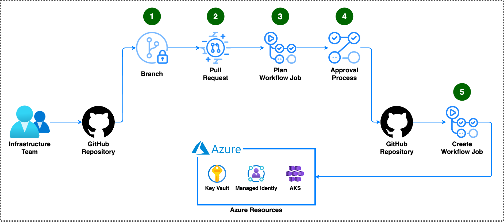

# Bicep deploy

This repository includes GitHub actions and a Azure DevOps [pipeline](./.azuredevops/README.md) to plan and deploy Azure infrastructure.

## Overview



1. The user creates a new branch, then commits and push the code.
1. The user creates a pull request.
1. The workflow is automatically triggered and starts the [plan job](#plan-job).
1. If the plan job was successful, the workflow will wait for a [required reviewer](#get-started) to approve the [deploy job](#deploy-job).
1. When a reviewer has approved, the workflow starts the [deploy job](#deploy-job) to deploy the code.

## Get started

To set up a bicep deploy workflow, several prerequisite steps are required:

1. Create an [environment](https://docs.github.com/actions/deployment/targeting-different-environments/using-environments-for-deployment#creating-an-environment).

1. To prevent unapproved deployments, add **"Required reviewers"** to the environment. Remember to save the protection rules after making changes.

1. Register a [Microsoft identity platform application](https://learn.microsoft.com/en-us/entra/identity-platform/quickstart-register-app).

1. Assign [Azure roles](https://learn.microsoft.com/en-us/azure/role-based-access-control/role-assignments-steps) to the application so it can deploy Azure infrastructure. For example, give it the **"Owner"** role on the target Azure subscription.

1. Give the repository Azure login permission:

   - **Option 1**: Add [federated credentials](https://docs.microsoft.com/azure/developer/github/connect-from-azure?tabs=azure-portal%2Clinux#use-the-azure-login-action-with-openid-connect) (recommended)

     - Use the scenario **"GitHub Actions deploying Azure resources"**.
     - Select entity type **"Pull request"** (needed for the [plan job](#plan-job)).
     - Save the credential.
     - Add another federated credential with the scenario **"GitHub Actions deploying Azure resources"**.
     - Select entity type **"Environment"** (needed for the [deploy job](#deploy-job)).
     - Specify the environment name that was created in step 1.
     - Save the credential.

     Note that there is a limit of 20 federated credentials per application. For this reason, and for security reasons, it is recommended to create a separate application for each repository.

   - **Option 2**: Add [client secret](https://learn.microsoft.com/en-us/entra/identity-platform/quickstart-register-app#add-a-client-secret)

     - Add the secret from the app registration as a secret in the repository. Remember that the secret must be replaced when it expires.
     - Add **"AZURE_CLIENT_SECRET"** to the workflow, see [passing secrets](#passing-secrets).

### Auto merge

To allow pull requests to merge automatically once all required reviews and status checks have passed, enable **"Allow auto-merge"** in the repository settings under **"General"**.

To clean up the head branch after merge, enable **"Automatically delete head branches"** on the same page.

For auto merge to work as intended, enable [branch protection](#branch-protection).

### Branch protection

It is recommended to protect the default branch. This is done in the repository settings under **"Branches"**.

Recommended branch protection for production use:

- Require a pull request before merging
  - Require approvals
  - Dismiss stale pull request approvals when new commits are pushed
  - Require approval of the most recent reviewable push
- Require status checks to pass before merging
  - Require branches to be up to date before merging
  - Add the following status checks:
    - 🏃 Deploy
- Require conversation resolution before merging
- Require linear history
- Require deployments to succeed before merging (and select the environment that must succeed)

This ensures that no changes to the pull request are possible between the approval and the merging and that a successful plan and deploy has occurred.

## Workflow

The workflow is designed to run when a pull request is created or updated.

It has been tested on a [standard GitHub-hosted runner](https://docs.github.com/en/actions/using-github-hosted-runners/about-github-hosted-runners/about-github-hosted-runners#standard-github-hosted-runners-for-public-repositories) with workflow label **"ubuntu-22.04"**.

The concurrency setting is configured to ensure that only one workflow runs at any given time. If a new workflow starts with the same name, GitHub Actions will cancel any workflow already running with that name.

The following tools are used:

- [Azure CLI](https://learn.microsoft.com/en-us/cli/azure/)
  - [az login](https://learn.microsoft.com/en-us/cli/azure/reference-index?view=azure-cli-latest#az-login)
  - [az bicep build](https://learn.microsoft.com/en-us/cli/azure/bicep?view=azure-cli-latest#az-bicep-build)
  - [az bicep build-params](https://learn.microsoft.com/en-us/cli/azure/bicep?view=azure-cli-latest#az-bicep-build-params)
  - [az provider register](https://learn.microsoft.com/en-us/cli/azure/provider?view=azure-cli-latest#az-provider-register)
  - [az deployment {SCOPE} create](https://learn.microsoft.com/en-us/cli/azure/deployment/sub?view=azure-cli-latest#az-deployment-sub-create)
  - [az deployment {SCOPE} validate](https://learn.microsoft.com/en-us/cli/azure/deployment/sub?view=azure-cli-latest#az-deployment-sub-validate)
  - [az deployment {SCOPE} what-if](https://learn.microsoft.com/en-us/cli/azure/deployment/sub?view=azure-cli-latest#az-deployment-sub-what-if)
- [Azure Cost Estimator](https://github.com/TheCloudTheory/arm-estimator)
- [curl](https://curl.se/)
- GitHub actions:
  - [checkout](https://github.com/actions/checkout/tree/b4ffde65f46336ab88eb53be808477a3936bae11)
  - [github-script](https://github.com/actions/github-script/tree/60a0d83039c74a4aee543508d2ffcb1c3799cdea)
  - [microsoft/ps-rule](https://github.com/microsoft/ps-rule/tree/001a0fcdab97b1d83e25c559163ecececc80cc6f)
  - [upload-artifact](https://github.com/actions/upload-artifact/tree/ef09cdac3e2d3e60d8ccadda691f4f1cec5035cb)
- [GNU bash](https://www.gnu.org/software/bash/)
- [GNU bc](https://www.gnu.org/software/bc/)
- [GNU core utilities](https://www.gnu.org/software/coreutils/coreutils.html)
- [GNU find utilities](https://www.gnu.org/software/findutils/)
- [jq](https://jqlang.github.io/jq/)
- [sed](https://www.gnu.org/software/sed/)
- [unzip](https://infozip.sourceforge.net/)

### Plan job

The plan job will build and test the code. If no issues are found in the code, a [what-if](https://docs.microsoft.com/cli/azure/deployment/sub#az-deployment-sub-what-if) report is generated.

The PSRule steps will only run if **"rule_option"** is specified and points to a file that exist.

For more information about PSRule configuration, see:

- [Sample ps-rule.yaml](./ps-rule.yaml)
- [Configuring options](https://azure.github.io/PSRule.Rules.Azure/setup/configuring-options/)
- [Configuring rule defaults](https://azure.github.io/PSRule.Rules.Azure/setup/configuring-rules/)
- [Available Options](https://microsoft.github.io/PSRule/v2/concepts/PSRule/en-US/about_PSRule_Options/)
- [Available Rules by resource type](https://azure.github.io/PSRule.Rules.Azure/en/rules/resource/)

### Deploy job

The deploy job will only run when the plan job was successful.

A specific [environment](#get-started) must be specified for this job.

If the environment is configured with **required reviewers**, the job will require manual approval.

#### Service connections for new subscriptions

A role assignment that was just created, or a subscription that was just created or moved between management groups, can be invisible to the pipeline identity for a while, and can come back invisible after a successful sign-in ("The subscription of '&lt;id&gt;' doesn't exist in cloud 'AzureCloud'"). In observed runs this lasted more than an hour.

The scripts select the subscription themselves and retry **only that error**: each attempt refreshes and logs the subscriptions the identity can see, for up to the number of minutes in **subscription_wait_minutes** (default 30). Any other error, such as a missing permission, fails at once.

#### Deployment stacks (opt-in)

Set **deployment_mode** to `stack` to plan and deploy the template as an [Azure deployment stack](https://learn.microsoft.com/azure/azure-resource-manager/bicep/deployment-stacks) instead of a standard deployment. The default is `deployment`, and nothing changes unless you opt in.

- **Plan.** The what-if runs as a deployment stack what-if (`az stack-whatif`). The PR comment starts with a summary (to create, modify, delete, detach, unsupported, unchanged), lists any resource the stack would delete or detach, and then shows the full change set.
- **Deploy.** The template is deployed with `az stack ... create`.
- **Unmanaged resources.** **stack_action_on_unmanage** sets what happens to a resource that is removed from the template. The default `detachAll` never deletes anything: the resource is only released from the stack. `deleteResources` and `deleteAll` delete it.
- **Delete gate.** When the stack would delete a resource, the plan **fails** unless that resource ID is listed in the JSON array file named by **stack_approved_deletes**, so every delete is approved in a reviewed commit. With a delete mode, the plan also fails when Azure reports the what-if result as not deterministic (some resource names are only known at deploy time), because then not every delete can be shown.
- **Deploy exactly what was planned.** The plan records its mode and stack settings (the `stack_settings` output; pass it to the deploy action as **plan_stack_settings**). A deployment with different settings, for example `deleteAll` after a plan with `detachAll`, fails and asks for a new plan. With a delete mode, the deployment also runs the delete gate again on the current state just before deploying, because the plan can be old. The gate also fails when the what-if result is missing or incomplete.
- **Deny settings.** **stack_deny_settings_mode** (`none` by default, or `denyDelete` / `denyWriteAndDelete`).
- **Stack name.** **stack_name**, by default the repository name. The stack is created at the deployment scope (resource group, subscription or management group).
- **Adopting existing resources.** The first stack plan for resources that a standard deployment created shows them as adopted (`notManaged` => `managed`). That plan, and later ones, can also show property differences that Azure set itself, such as provider defaults or tags that a policy rewrites on every deployment. Azure's noise reduction for stack what-if is meant to filter many of these, but it does not remove all of them, so read them as possible noise. A template whose resource names are only known at deploy time also makes the what-if result non-deterministic: those resources can be listed as detached (or, with a delete mode, deleted) even though the deployment keeps them, which is why delete modes fail the plan in that case.
- **Fallback.** Templates that use Bicep extensions, and tenant-scope deployments, are not supported by deployment stacks. They are deployed as a standard deployment, with a warning.
- Requires an Azure CLI with the `stack-whatif` command.

#### Bicep CLI version

The Bicep CLI is not pinned. Every plan installs and uses the **latest** Bicep release, so new Bicep features are available as soon as they ship. The first step that compiles picks the version and every later step of the plan uses the same one, so the build, PSRule, the cost estimate and the what-if all see the same compiled template. If the latest release cannot be installed, the plan stops rather than continue with an older compiler. The version is shown in the plan logs and in the PR comment.

The deployment then uses **the same version the plan used**, so it compiles exactly the template that the what-if showed, even if a newer Bicep was released while the deployment waited for approval. This works like Atlantis, which applies a Terraform plan only with the Terraform version that made it. If that version cannot be installed, the deployment stops with a message to run the plan again, because the reviewed what-if no longer describes what would be deployed.

A new Bicep release can change the compiled output. When it does, the next plan shows that change in the what-if (and in the Bicep snapshot, if one is used) for review like any other change.

With the GitHub actions, pass the plan's `bicep_version` output to the deploy action's `bicep_version` input, as in the [usage](#usage) example. Without it, the deployment uses the latest version.

### Passing secrets

It is optional to pass **"azure_client_id"**, **"azure_subscription_id"** and **"azure_tenant_id"** as secret.

Secrets are masked in the job log. The result is that IDs can't be seen and it may be difficult to see if the wrong ID is used.

On the other hand, passing these values as secrets will make them less exposed and is therefore the more secure option.

When using **"Option 2"** in [Get started](#get-started), the input **"azure_client_secret"** is needed and must be passed as a secret.

Secrets are passed using the secrets syntax, for example:

```yaml
with:
  azure_client_id: ${{ secrets.AZURE_CLIENT_ID }}
  azure_client_secret: ${{ secrets.AZURE_CLIENT_SECRET }}
  azure_subscription_id: ${{ secrets.AZURE_SUBSCRIPTION_ID }}
  azure_tenant_id: ${{ secrets.AZURE_TENANT_ID }}
```

### Action Inputs

#### Required

- **azure_client_id**: (Required) The client ID of the service principal for Azure login.

  This service principal must have permission to deploy within the Azure subscription.

- **azure_subscription_id**: (Required) The subscription ID in which to deploy the resources.

- **azure_tenant_id**: (Required) The tenant ID in which the subscription exists.

- **location**: (Required) The Azure location to store the deployment metadata.

- **scope**: (Required) The deployment scope. Accepted: tenant, mg, sub, group.

- **template**: (Required) The template address. A path or URI to a file or a template spec resource id.

#### Optional

- **artifact_identifier**: A unique identifier added to artifact name in case of multiple runs within one workflow.

- **auto_merge**: Auto merge method to use after successful deployment.

  Can be one of:

  - merge
  - squash
  - rebase
  - disable (turn off auto merge)

  Default: **"squash"**

- **azure_providers**: A comma separated list of Azure resource providers.

  The workflow will try to register the specified providers in addition to the providers that is detected in code by deployment validate.

  Use the value **"disable"** to prevent the workflow from trying to register Azure resource providers.

  Default: **""**

- **azure_provider_wait_count**: Times to check provider status before giving up.

  Default: **"30"**

- **azure_provider_wait_seconds**: Seconds to wait between each provider status check.

  Default: **"10"**

- **bicep_version**: (Deploy action) The Bicep CLI version the plan used, from the plan action's `bicep_version` output. The deployment installs and uses this version so it compiles exactly what the plan showed. If the version cannot be installed, the deployment fails and asks for a new plan. See [Bicep CLI version](#bicep-cli-version).

  Default: **""** (use the latest version)

- **deployment_mode**: (Plan and deploy actions) `deployment` or `stack`. See [Deployment stacks (opt-in)](#deployment-stacks-opt-in). Use the same value and the stack inputs below in both actions.

  Default: **"deployment"**

- **stack_action_on_unmanage**, **stack_deny_settings_mode**, **stack_name**: (Plan and deploy actions) Stack settings, used when deployment_mode is `stack`.

  Defaults: **"detachAll"**, **"none"**, **""** (the repository name)

- **stack_approved_deletes**: (Plan and deploy actions) Path to a JSON array of resource IDs the stack may delete. The deploy action uses it to check deletes again before deploying with a delete mode.

  Default: **""**

- **plan_stack_settings**: (Deploy action) The plan action's `stack_settings` output. Required for a stack deployment; a deployment whose settings differ from the plan fails.

  Default: **""**

- **subscription_wait_minutes**: (Plan and deploy actions) Minutes to wait for the subscription to become visible to the signed-in identity. Only the "doesn't exist in cloud" error is retried. See [Service connections for new subscriptions](#service-connections-for-new-subscriptions).

  Default: **"30"**

- **cost_threshold**: Max acceptable estimated cost. Exceeding threshold causes plan to fail.

  A value of **"-1"** means no cost threshold.

  Default: **"-1"**

- **currency**: Currency code to use for estimations.

  See allowed values at <https://github.com/TheCloudTheory/arm-estimator/wiki/Options#currency>

  Default: **"EUR"**

- **log_severity**: The log verbosity. Can be one of:

  - **ERROR**: Only show errors, suppressing warnings.
  - **INFO**: Standard log level.
  - **VERBOSE**: Increase logging verbosity.
  - **DEBUG**: Show all debug logs.

  Default: **ERROR**

- **management_group**: Management group to create deployment at for mg scope.

  Default: **""**

- **resource_group**: Resource group to create deployment at for group scope.

  Default: **""**

- **rule_baseline**: The name of a PSRule baseline to use.

  For a list of baseline names for module PSRule.Rules.Azure see <https://azure.github.io/PSRule.Rules.Azure/en/baselines/Azure.All/>

  When empty, PSRule uses `Azure.Default`, which picks up every new rule as soon as a new PSRule.Rules.Azure version is installed, so a plan that passed yesterday can fail today without any change to your code. To keep results stable, set a quarterly baseline such as `Azure.GA_2026_03` and move to a newer one when you are ready for the new rules. Older quarterly baselines still work but log an obsolete warning. A quarterly baseline ignores custom (local) rules unless `Rule.IncludeLocal: true` is set in the options file. To turn off a single rule instead, exclude it in the options file (`rule: { exclude: [Azure.VNET.PrivateSubnet] }`). See <https://azure.github.io/PSRule.Rules.Azure/working-with-baselines/>.

  Default: **Azure.Default**

- **rule_modules**: A comma separated list of modules to use for analysis.

  For a list of modules see <https://www.powershellgallery.com/packages?q=Tags%3A%22PSRule-rules%22>

  Default: **Az.Resources,PSRule.Rules.Azure**

- **rule_option**: The path to an options file. If empty, PSRule will be skipped.

  For example: `bicep/pattern1/ps-rule.prod.yaml`

  Default: **""**

- **template_parameters**: Deployment parameter values.

  Either a path, URI, JSON string, or <KEY=VALUE> pairs.

  For example: `bicep/pattern1/main.prod.bicepparam`

  Default: **""**

- **version_ace_tool**: Azure Cost Estimator version. If empty, cost estimator will be skipped.

  See versions at <https://github.com/TheCloudTheory/arm-estimator/releases>.

  Version 1.6 cannot parse templates that Bicep compiles with `languageVersion` 2.0 (for example when user-defined types are used) and fails the step. Use 1.6.5 or later.

  Default: **"1.6.5"**

### Usage

```yaml
name: Azure Deploy
on:
  pull_request:
    branches: [main]
    paths: ["**.bicep*"] # for multiple workflows, limit to a path: "ptn/avd/**.bicep*"
    types: [opened, synchronize]

concurrency:
  group: ${{ github.workflow }}
  cancel-in-progress: true

permissions: {}

env:
  auto_merge: squash
  azure_client_id: d0d0d0d0-4558-43bb-896a-008e763058bd # when using a secret, remove this line and add the secret to each job below
  azure_providers: Microsoft.Advisor,Microsoft.AlertsManagement,Microsoft.Authorization,Microsoft.Consumption,Microsoft.EventGrid,microsoft.insights,Microsoft.ManagedIdentity,Microsoft.Management,Microsoft.Network,Microsoft.PolicyInsights,Microsoft.ResourceHealth,Microsoft.Resources,Microsoft.Security
  azure_provider_wait_count: 30
  azure_provider_wait_seconds: 10
  azure_subscription_id: d0d0d0d0-ed29-4694-ac26-2e358c364506 # when using a secret, remove this line and add the secret to each job below
  azure_tenant_id: d0d0d0d0-b93b-4f96-9e73-4ea6caa2f3b4 # when using a secret, remove this line and add the secret to each job below
  cost_threshold: 1000
  currency: EUR
  location: westeurope
  log_severity: INFO
  rule_option: ps-rule.yaml
  scope: sub
  template: main.bicep
  template_parameters: main.bicepparam # parameters can be passed inline too, like this: namePrefix=t serviceShort=tstsp3
  version_ace_tool: "1.6.5"

jobs:
  plan:
    name: 🗓️ Plan
    permissions:
      contents: read # for checkout
      id-token: write # for Azure login with open id
      pull-requests: write # for pull request comment
    outputs:
      providers: ${{ steps.plan.outputs.providers }}
      bicep_version: ${{ steps.plan.outputs.bicep_version }}
      stack_settings: ${{ steps.plan.outputs.stack_settings }}
    runs-on: ubuntu-22.04
    steps:
      - name: Checkout
        uses: actions/checkout@v4

      - name: Plan
        id: plan
        uses: innofactororg/bicep-action/.github/actions/plan@v1
        with:
          azure_client_id: ${{ env.azure_client_id }} # for secret, use ${{ secrets.AZURE_CLIENT_ID }}
          # azure_client_secret: ${{ secrets.AZURE_CLIENT_SECRET }} # use this if choosing Option 2 in Get started
          azure_providers: ${{ env.azure_providers }}
          azure_subscription_id: ${{ env.azure_subscription_id }} # for secret, use ${{ secrets.AZURE_SUBSCRIPTION_ID }}
          azure_tenant_id: ${{ env.azure_tenant_id }} # for secret, use ${{ secrets.AZURE_TENANT_ID }}
          cost_threshold: ${{ env.cost_threshold }}
          currency: ${{ env.currency }}
          location: ${{ env.location }}
          log_severity: ${{ env.log_severity }}
          rule_option: ${{ env.rule_option }}
          scope: ${{ env.scope }}
          template: ${{ env.template }}
          template_parameters: ${{ env.template_parameters }}
          version_ace_tool: ${{ env.version_ace_tool }}

  deploy:
    name: 🏃 Deploy
    needs: plan
    environment: production
    permissions:
      contents: write # for auto merge
      id-token: write # for Azure login with open id
      pull-requests: write # for pull request comment
    runs-on: ubuntu-22.04
    steps:
      - name: Checkout
        uses: actions/checkout@v4

      - name: Deploy
        id: deploy
        uses: innofactororg/bicep-action/.github/actions/deploy@v1
        with:
          auto_merge: ${{ env.auto_merge }}
          azure_client_id: ${{ env.azure_client_id }} # for secret, use ${{ secrets.AZURE_CLIENT_ID }}
          # azure_client_secret: ${{ secrets.AZURE_CLIENT_SECRET }} # use this if choosing Option 2 in Get started
          azure_providers: ${{ needs.plan.outputs.providers }}
          bicep_version: ${{ needs.plan.outputs.bicep_version }}
          plan_stack_settings: ${{ needs.plan.outputs.stack_settings }}
          azure_provider_wait_count: ${{ env.azure_provider_wait_count }}
          azure_provider_wait_seconds: ${{ env.azure_provider_wait_seconds }}
          azure_subscription_id: ${{ env.azure_subscription_id }} # for secret, use ${{ secrets.AZURE_SUBSCRIPTION_ID }}
          azure_tenant_id: ${{ env.azure_tenant_id }} # for secret, use ${{ secrets.AZURE_TENANT_ID }}
          location: ${{ env.location }}
          log_severity: ${{ env.log_severity }}
          scope: ${{ env.scope }}
          template: ${{ env.template }}
          template_parameters: ${{ env.template_parameters }}
```

## License

The code and documentation in this project are released under the [BSD 3-Clause License](./LICENSE).
