# How it works

bicep-action runs Bicep the way Terraform teams use Atlantis. Every change is **planned in the pull request**, the plan is **reviewed by people**, and only an **approved plan is deployed**. GitHub Actions and Azure DevOps run the same shell scripts and post the same pull request comments.

- [The flow](#the-flow)
- [The plan job](#the-plan-job)
- [The deploy job](#the-deploy-job)
- [Deploy exactly what was planned](#deploy-exactly-what-was-planned)
- [The what-if](#the-what-if)
- [Deployment stacks and the delete gate](#deployment-stacks-and-the-delete-gate)
- [Bicep snapshot](#bicep-snapshot)
- [Cost estimate](#cost-estimate)
- [PSRule analysis](#psrule-analysis)
- [Bicep CLI version](#bicep-cli-version)
- [Existing tags](#existing-tags)
- [What-if summary file](#what-if-summary-file)
- [New subscriptions and role assignments](#new-subscriptions-and-role-assignments)
- [Logs and artifacts](#logs-and-artifacts)
- [Tools used](#tools-used)

## The flow

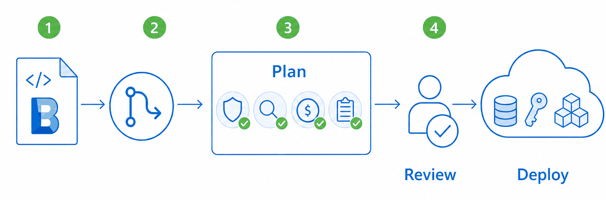

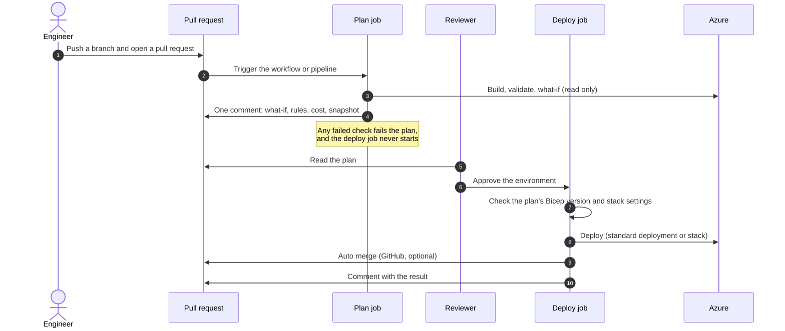

1. An engineer pushes a branch and opens a pull request.
2. The workflow (GitHub) or pipeline (Azure DevOps) starts the **plan job**.
3. The plan job builds and checks the template, asks Azure what would change, and posts **one comment** with the result.
4. The deploy job waits for a reviewer to approve the **environment**, which is a GitHub environment with required reviewers, or an Azure DevOps environment with an approval check.
5. After approval the **deploy job** deploys, comments the result on the same pull request, and on GitHub turns on auto merge.

The plan job only reads from Azure. Nothing changes in Azure until a person has approved the plan.

## The plan job

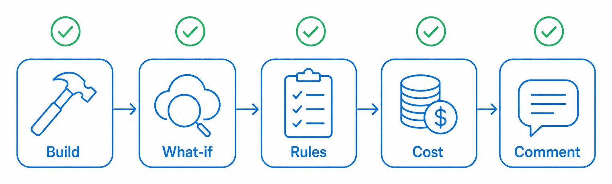

| # | Step | What it does | Fails the plan when |
|---|------|--------------|---------------------|
| 1 | Install tools | Logs the Azure CLI version and installs Bicep; in Azure DevOps, first downloads the scripts at `WORKFLOW_VERSION`. | A tool or script cannot be installed. |
| 2 | Azure login *(GitHub)* | Signs in with OpenID Connect or a client secret, and waits for a new subscription to become visible. | The identity cannot sign in or never sees the subscription. |
| 3 | Existing tags *(opt-in)* | Reads chosen tag values from the existing resources into `EXISTING_TAGS`. See [Existing tags](#existing-tags). | The tags cannot be read. |
| 4 | Bicep build | Compiles `.bicep` to ARM JSON with the **latest** Bicep release. | The template does not compile. |
| 5 | Bicep build params | Compiles a `.bicepparam` file. | The parameters do not compile. |
| 6 | Validate | `az deployment <scope> validate`, and finds the resource providers the template uses. | Azure rejects the template. |
| 7 | What-if | `az deployment <scope> what-if`, or `az stack-whatif` in stack mode. Runs the delete gate and writes `whatif-summary.json`. | The what-if fails, or the stack would delete a resource that is not approved. |
| 8 | PSRule *(opt-in)* | Runs PSRule for Azure on the repository. | A rule fails, or PSRule cannot expand a file. |
| 9 | Cost estimate | Runs the Azure Cost Estimator (ACE) on the compiled template. | The estimate exceeds `cost_threshold`, or it cannot be made while a threshold is set. |
| 10 | Bicep snapshot *(automatic)* | Compares the template with a committed `<name>.snapshot.json`. | The template no longer matches the committed snapshot. |
| 11 | Comment | Posts all results as one pull request comment. | Never; the comment is posted even when a step failed. |
| 12 | Upload logs | Publishes the logs folder as an artifact. | Never. |

Steps 8 to 10 are optional. Each one is skipped when it is not configured: no `rule_option`, an empty `version_ace_tool`, or no snapshot file.

What the comment looks like:

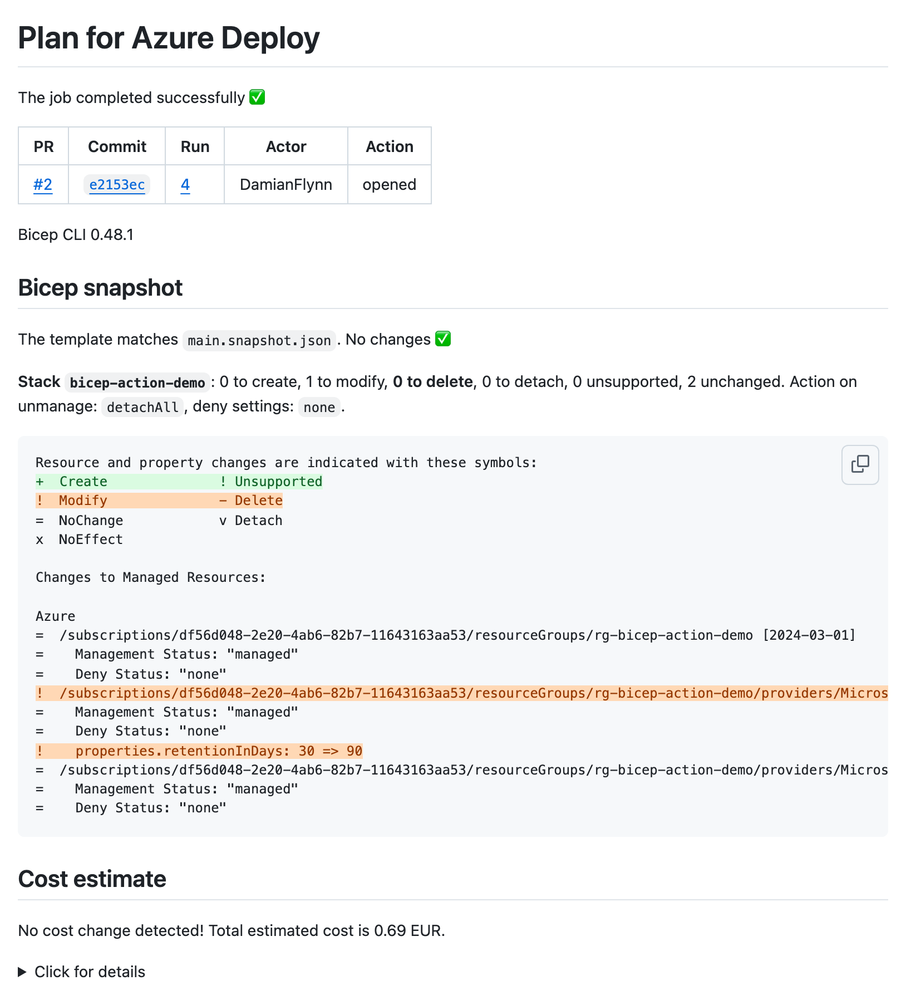

## The deploy job

The deploy job runs only when the plan succeeded, and only after the environment has been approved.

| # | Step | What it does |
|---|------|--------------|
| 1 | Install tools and sign in | The same as in the plan job. |
| 2 | Existing tags *(opt-in)* | Reads the tags **again**. It does not reuse the plan's values, because resources can change while the plan waits for approval. |
| 3 | Register providers | Registers the providers the plan found, plus `azure_providers`, and waits until they are registered. |
| 4 | Deploy | Installs the **plan's** Bicep version, checks the plan's stack settings, and deploys. With a delete mode it runs the delete gate again first. |
| 5 | Auto merge *(GitHub)* | Turns on auto merge for the pull request (`auto_merge`, `squash` by default). |
| 6 | Comment | Posts the result on the pull request. |
| 7 | Upload logs | Publishes the logs folder as an artifact. |

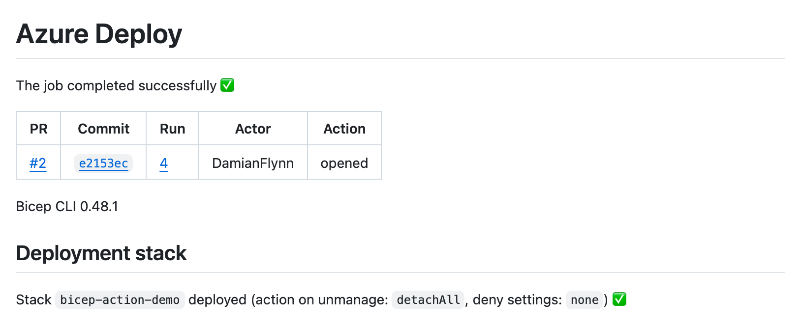

## Deploy exactly what was planned

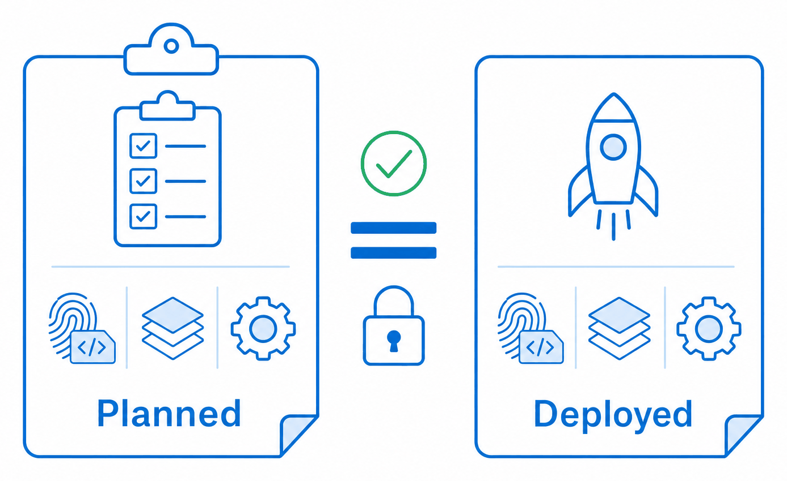

A reviewer approves a specific what-if. The deploy job makes sure that what-if is what gets deployed:

- **The same Bicep version.** The plan records the Bicep CLI version it compiled with (`bicep_version` output). The deployment installs that version, even if a newer Bicep came out while it waited for approval. If that version can no longer be installed, the deployment stops and asks for a new plan.
- **The same mode and stack settings.** The plan records its mode and stack settings (`stack_settings` output). A deployment with different settings fails. For example, `deleteAll` after a plan made with `detachAll` fails and asks for a new plan.
- **Deletes checked again.** With a delete mode (`deleteResources` or `deleteAll`), the deployment runs the delete gate again on the current state just before it deploys, because the plan can be hours old.

In Azure DevOps the deploy stage reads these values from the plan stage automatically. With GitHub, pass the plan action's outputs to the deploy action, as in the [examples](./examples/github/).

## The what-if

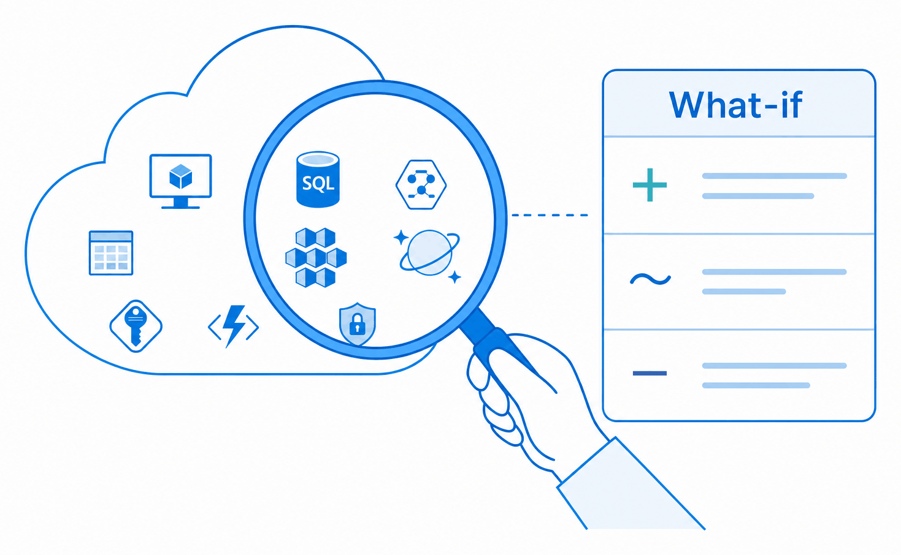

The what-if asks Azure what the deployment **would** change, without changing anything. It is the heart of the plan comment.

- **Standard deployment.** `az deployment <scope> what-if`. Resources that would not change, or that Azure ignores, are left out, so the comment shows only real changes.
- **Deployment stack.** `az stack-whatif`. It also shows which resources the stack would **detach** or **delete** because they left the template. See the next section.

The comment shows the result as a `diff` block, so the changes are coloured:

| Line starts with | Meaning |
|---|---|
| `+` | Create |
| `-` | Delete |
| `!` | Modify. Azure prints `~`; it is shown as `!` so the diff highlights it. |
| `=` | No change (stack what-if) |
| `x`, `v` | Property-level markers that Azure uses, for example a value with no effect |

Property changes are listed under each resource. Long results are folded under **Click for details**.

What the what-if cannot know:

- **Values only known at deploy time,** such as `reference()` output or a name built from a runtime value, show as unsupported or not deterministic.
- **Changes Azure makes itself,** such as provider defaults or tags a policy adds, can appear as modifications on every plan. Read them as possible noise.

The counts and the delete, detach and unsupported IDs are also written to [`whatif-summary.json`](#what-if-summary-file) for automation.

## Deployment stacks and the delete gate

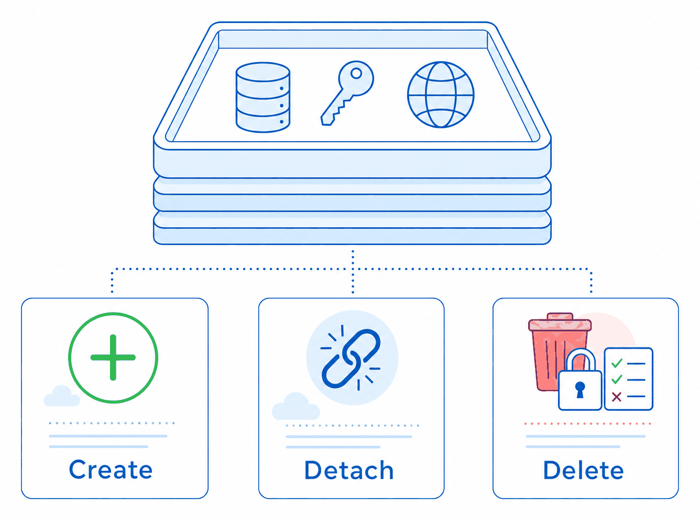

With `deployment_mode: stack`, the template is deployed as an [Azure deployment stack](https://learn.microsoft.com/azure/azure-resource-manager/bicep/deployment-stacks). Azure then knows which resources belong to the template, so the plan can show what would be **deleted** or **detached** when something is removed from the code. This is the recommended mode for new pipelines.

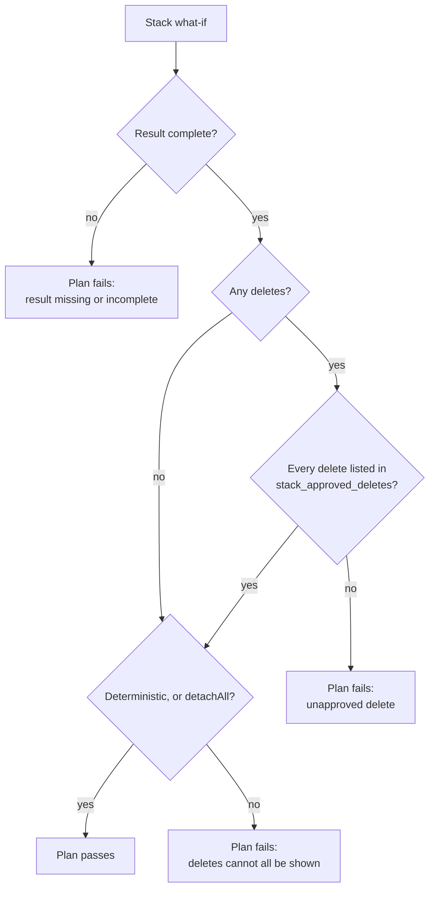

- **Unmanaged resources.** `stack_action_on_unmanage` decides what happens to a resource that is removed from the template.
  - `detachAll`, the default, never deletes anything. The resource is only released from the stack.
  - `deleteResources` and `deleteAll` delete it.
- **Approved deletes.** When the stack would delete a resource, the plan fails unless that resource ID is listed in the JSON array file named by `stack_approved_deletes`. Every delete is therefore approved in a reviewed commit.
- **Not deterministic.** Some resource names are only known at deploy time. Azure then reports the what-if as not deterministic, and it cannot show every resource that might be deleted.
  - With a delete mode the plan fails, because a delete might be hidden.
  - With `detachAll` the result is only reported, because nothing can be deleted.
- **Deny settings.** `stack_deny_settings_mode` can be `none` (the default), `denyDelete` or `denyWriteAndDelete`. With either deny mode, Azure blocks changes made outside the pipeline.
- **Adopting existing resources.** The first stack plan for resources that a standard deployment created shows them as adopted (`notManaged` ⇒ `managed`). That plan, and later ones, can also show property changes that Azure made itself, such as provider defaults or tags that a policy rewrites. Read these as possible noise.
- **Fallback.** Tenant-scope deployments, and templates that use Bicep extensions, cannot be stacks. They are deployed as a standard deployment, with a warning.

## Bicep snapshot

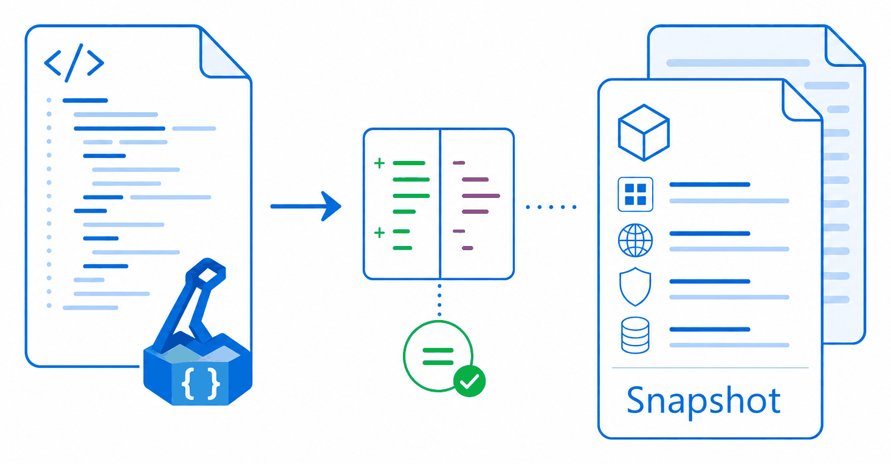

A Bicep snapshot is a committed file, `<name>.snapshot.json`, that lists every resource the template produces, fully expanded. The Bicep CLI computes it offline (`bicep snapshot`). When the parameters file is a `.bicepparam` and a matching snapshot sits next to it, the plan checks the template against it:

- **It matches.** The comment says **No changes**.
- **It differs.** The comment shows the difference, and the plan **fails** until the snapshot is updated. When the change is intended, run the command shown in the comment and commit the new snapshot. Reviewers then see the exact change to the deployed resources in the pull request diff.
- **No snapshot file.** The step is skipped.

Things to know:

- The snapshot depends on the scope values: subscription, resource group, management group, tenant and location. The command in the comment already contains them.
- Regenerate the snapshot only when the check reports a difference. Bicep does not write the `outputs` section in a stable order, so a regenerated file can look reordered even when nothing changed.
- Values of `@secure()` parameters are not written to the snapshot. Other parameter values are written in plain text, as in a parameters file.
- When the plan uses a newer Bicep than the one that made the snapshot, the comment says so. A Bicep release that changes the compiled output still fails the check, so that change is reviewed like any other.
- Tenant scope is only partly supported: there is no subscription, so the snapshot is evaluated with the tenant and location only.
- With [existing tags](#existing-tags), the snapshot contains the tag values. Limit them to the template's own resource groups with `existing_tags_resource_groups`, or the snapshot breaks whenever an unrelated resource changes a tag.

## Cost estimate

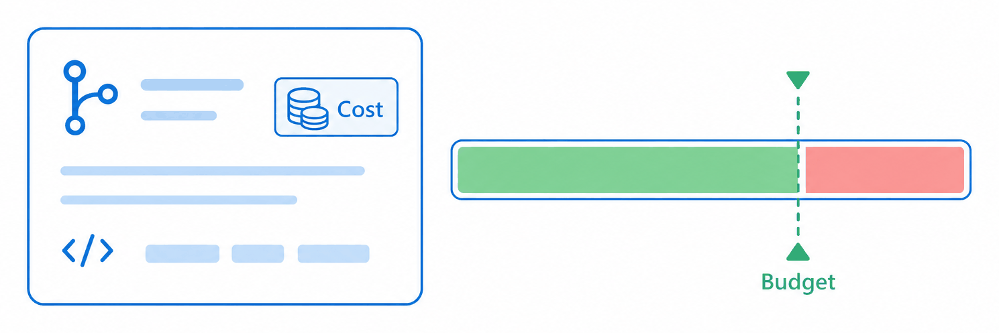

The plan runs the [Azure Cost Estimator](https://github.com/TheCloudTheory/arm-estimator) on the compiled template and puts the monthly estimate in the comment.

| `cost_threshold` | Over the threshold | Estimator fails (download, crash, unsupported resource) |
|---|---|---|
| `-1`, the default (report only) | Not checked | Warning, and the comment says the estimate is unavailable. The plan continues. |
| A number, for example `1000` | **Plan fails** | **Plan fails**, because the cost is then not known to be under the limit. |

`currency` is `EUR` when empty. Use ACE 1.6.5 or later: 1.6 cannot read templates that Bicep compiles with `languageVersion` 2.0, for example when user-defined types are used. An empty `version_ace_tool` skips the estimate.

## PSRule analysis

With `rule_option` set to a PSRule options file, the plan runs [PSRule for Azure](https://azure.github.io/PSRule.Rules.Azure/) on the repository and puts the results in the comment. A failed rule fails the plan.

- **Baselines.** `Azure.Default` picks up every new rule as soon as a new PSRule.Rules.Azure version is released, so a plan that passed yesterday can fail today without any change to your code. For stable results, pin a quarterly baseline such as `Azure.GA_2026_03` and move to a newer one when you are ready.
- **Excluding a rule.** Exclude it in the options file, for example `rule: { exclude: [Azure.VNET.PrivateSubnet] }`. A [sample options file](../ps-rule.yaml) is in this repository.
- **Bicep.** PSRule expands `.bicep` and `.bicepparam` files with the same Bicep version the plan compiled with.
- **Errors.** When PSRule fails without a rule failing, for example because it could not expand a file, the message says so. It does not blame a rule.

## Bicep CLI version

The Bicep CLI is **not pinned**. Every plan installs the **latest** Bicep release, so new features arrive as soon as they ship. Every step of one plan uses the same version: the build, PSRule, the cost estimate, the what-if and the snapshot check. If the latest release cannot be installed, the plan stops rather than fall back to an older compiler. The version is shown in the logs and in the comment.

The deployment uses the version the plan used. See [Deploy exactly what was planned](#deploy-exactly-what-was-planned).

## Existing tags

Some tags must keep the value they got when a resource was created, for example `createdOn`. Bicep cannot do that alone:

- `utcNow()` gives the time of every deployment, not of the first one.
- A tags write replaces the whole tag set.
- An `existing` reference fails when the resource is absent.

Set `existing_tags_keys` to the tag names, for example `createdOn`. Before the first compile of the plan, and again before the deployment, a step reads those tags from Azure and gives them to the template as the environment variable `EXISTING_TAGS`:

```json
{ "/subscriptions/<id>/resourcegroups/rg-app": { "createdOn": "2026-10-29T13:48:57Z" } }
```

- **Keys** are resource IDs in lower case. Only resources that carry at least one of the requested tags are listed.
- **Tag names** are matched without regard to case, as Azure does, and written with the spelling you asked for.
- **Scope.** `sub` reads the resource groups and the resources of the subscription. `group` reads the resource group and its resources. With any other scope the step is skipped with a warning.
- **Limit to your resource groups.** `existing_tags_resource_groups` takes names or prefixes, for example `rg-app-prod,rg-shared-*`. Only those groups and their resources are listed, which keeps platform resource groups out of the value and out of a [snapshot](#bicep-snapshot).
- **Failure.** If the tags cannot be read, the step fails. It never sets an empty object, which would let the template stamp new values on existing resources.
- **Size.** One environment variable holds about 128 KiB, so the step fails above 120,000 bytes. Request only the tags you need.

The parameter file reads the value with no default, so a missing value fails the compile:

```bicep
// main.bicepparam
param existingTags = json(readEnvironmentVariable('EXISTING_TAGS'))
```

The template keeps the stored value, or uses the current time for a new resource:

```bicep
// main.bicep
param existingTags object
param tags object = {}
param now string = utcNow()

func withCreatedOn(tags object, existing object, id string, now string) object =>
  union(tags, { createdOn: existing[?toLower(id)].?createdOn ?? now })

var rgName = 'rg-app'
var rgId = '${subscription().id}/resourceGroups/${rgName}'

module rg 'br/public:avm/res/resources/resource-group:<version>' = {
  params: {
    name: rgName
    tags: withCreatedOn(tags, existingTags, rgId, now)
  }
}
```

- Build a resource group ID as `${subscription().id}/resourceGroups/<name>`. `subscriptionResourceId('Microsoft.Resources/resourceGroups', ...)` returns a different form, which never matches.
- Child resources that a module creates, such as subnets, rules and role assignments, cannot be tagged and need no value.
- To compile on your own machine, set `EXISTING_TAGS='{}'` first.

## What-if summary file

Every plan writes its what-if result as JSON to `whatif-summary.json` in the logs artifact, whether or not it runs on a pull request. Automation, such as an approval gate that only allows plans without deletes, can read it without parsing `az` text. The path is also an output:

- GitHub: `whatif_summary` on the plan action.
- Azure DevOps: the `what_if.whatif_summary` output variable.

```json
{
  "schemaVersion": 1,
  "mode": "stack",
  "scope": "sub",
  "counts": { "create": 17, "modify": 0, "delete": 0, "deletePotential": 0, "detach": 0, "detachPotential": 0,
              "deploy": 0, "unsupported": 5, "unchanged": 0, "ignore": 0, "noEffect": 0, "other": 0 },
  "deletes": [],
  "detaches": [],
  "unsupported": ["<resource id>"],
  "deterministic": false,
  "blocked": false,
  "blockedReason": null,
  "stack": { "name": "<stack name>", "id": "<stack id>" },
  "stackSettings": { "actionOnUnmanage": "detachAll", "denySettingsMode": "none" },
  "bicepVersion": "0.49.2",
  "note": null
}
```

- **One shape.** `mode` is `stack` or `classic`, and the file has the same shape in both. In classic mode `stack` and `stackSettings` are `null` and `detach` is 0. When a stack falls back to a standard deployment, `mode` is `classic` and `note` gives the reason.
- **Counts.** `counts` match the comment. `delete` and `detach` include the potential ones, which are also counted in `deletePotential` and `detachPotential`.
- **Unknown changes.** `other` counts change types this version does not know. A gate should treat a non-zero `other` as unknown.
- **Blocked.** `blocked` is `true` when the delete gate failed the plan, and `blockedReason` says why.
- **Classic mode.** The counts come from a second, lighter what-if that returns resource IDs only. They include `unchanged` and `ignore`, which the comment leaves out.
- **Failures.** A failed what-if leaves no file. A result that cannot be read gives `"error"` and no counts, never zero counts. **A gate should fail closed** when the file is missing or has `error`.

There is a [GitHub example](./examples/github/auto-approve-safe-plans.yml) of such a gate.

## New subscriptions and role assignments

A role assignment that was just created can be invisible to the pipeline identity for a while, and so can a subscription that was just created or moved between management groups. Sometimes it even comes back invisible after a successful sign-in, with the error `The subscription of '<id>' doesn't exist in cloud 'AzureCloud'`. In observed runs this lasted more than an hour.

The scripts retry **only that error**, for up to `subscription_wait_minutes` (30 by default). Each attempt logs which subscriptions the identity can see. Any other error, such as a missing permission, fails at once.

## Logs and artifacts

Each job uploads its logs folder as an artifact:

| Artifact | Contains |
|---|---|
| `plan_logs_<id>_<attempt>` (Azure DevOps) / plan logs (GitHub) | One log and one Markdown file per step, the PSRule report, the cost estimate, `whatif-summary.json`. |
| `deploy_logs_<id>_<attempt>` (Azure DevOps) / deploy logs (GitHub) | The deployment logs and the comment. |

`artifact_identifier` (`ARTIFACT_IDENTIFIER`) keeps artifact names unique when several plans run in one workflow or pipeline, for example one per environment. In Azure DevOps, the attempt number keeps a re-run from overwriting the logs of the attempt before it. The upload never fails a job.

With `log_severity` (`IN_SEVERITY`) set to anything other than `ERROR`, or when a step fails, the job also prints debug information: the environment, the tool versions and the Azure context.

## Tools used

- [Azure CLI](https://learn.microsoft.com/cli/azure/): `az bicep`, `az deployment <scope> validate | what-if | create`, `az stack`, `az stack-whatif`, `az provider`
- [Bicep CLI](https://github.com/Azure/bicep), the latest release, installed on each plan
- [Azure Cost Estimator](https://github.com/TheCloudTheory/arm-estimator)
- [PSRule](https://microsoft.github.io/PSRule/) and [PSRule for Azure](https://azure.github.io/PSRule.Rules.Azure/). GitHub uses the `microsoft/ps-rule` action; Azure DevOps uses PowerShell with modules installed from the PowerShell Gallery.
- bash, curl, jq, GNU core utilities, sed, bc, unzip

It is tested on GitHub-hosted `ubuntu-24.04` runners and Microsoft-hosted `ubuntu-latest` agents.
