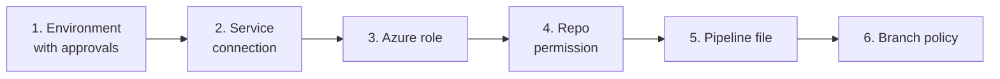

# Set up with Azure DevOps

This sets up an Azure Repos repository so every pull request is planned, reviewed and deployed by an Azure Pipeline. The pipeline downloads the bicep-action scripts from GitHub at the version you pin, so there is nothing to install.



## 1. Create an environment with an approval check

1. Go to **Pipelines → Environments → New environment**, for example `production`, with resource **None**.
2. Open the environment, then **Approvals and checks → Approvals**, and add the approvers.

The deploy stage targets this environment, so it waits for the approval. See [environments](https://learn.microsoft.com/azure/devops/pipelines/process/environments) and [approvals](https://learn.microsoft.com/azure/devops/pipelines/process/approvals).

## 2. Create a service connection

Create an [Azure Resource Manager service connection with workload identity federation](https://learn.microsoft.com/azure/devops/pipelines/release/configure-workload-identity). Its name is the `SERVICE_CONNECTION` variable, or the `serviceConnection` template parameter.

A connection scoped to a management group signs in at tenant level. The scripts then select `SUBSCRIPTION_ID` themselves, and wait for it if it is not yet visible.

## 3. Give the identity an Azure role

[Assign a role](https://learn.microsoft.com/azure/role-based-access-control/role-assignments-steps) to the service connection's identity at the deployment scope:

- **Contributor** for most templates.
- **Owner**, or **Contributor** plus **Role Based Access Control Administrator**, when the template creates role assignments.
- A deployment stack with deny settings needs `Microsoft.Resources/deploymentStacks/manageDenySetting/action`. Owner and **Azure Deployment Stack Owner** have it; Contributor does not.

Templates that touch resources in other subscriptions need roles there too. See [Cross-subscription permissions](./troubleshooting.md#cross-subscription-permissions).

## 4. Let the pipeline comment on pull requests

In **Project settings → Repositories → (your repo) → Security**, give the build service (`<project> Build Service (<organisation>)`) **Contribute to pull requests**. The pipeline posts its comments with `System.AccessToken`.

## 5. Add the pipeline

Pick a starting point:

| File | Use it for |
|---|---|
| [`ms.azure.deploy.yml`](../.azuredevops/ms.azure.deploy.yml) | **Start here.** One environment, all steps inline in one file, stacks and the cost estimate turned on. |
| [`multi-environment.yml`](./examples/azure-devops/multi-environment.yml) | Test, then production, with the reusable [stage templates](../.azuredevops/templates/). |
| [`variable-group.yml`](./examples/azure-devops/variable-group.yml) | Settings kept in a variable group instead of the file. |

1. Add the file to a folder, for example `.pipelines/azure-deploy.yml`, and set the variables. See the [configuration reference](./configuration.md). Set `WORKFLOW_VERSION` to a release tag such as `v1`.
2. Commit the template, its `.bicepparam` file, a [`ps-rule.yaml`](../ps-rule.yaml), and optionally a Bicep snapshot.
3. Go to **Pipelines → New pipeline → Azure Repos Git**, select the repository, choose **Existing Azure Pipelines YAML file**, and select the file.
4. **Save** it without running it.

The pipeline runs on Microsoft-hosted `ubuntu-latest` agents. A self-hosted agent needs bash, the Azure CLI, PowerShell (for PSRule), curl, jq and unzip.

## 6. Add a build validation branch policy

Under **Repos → Branches → (default branch) → Branch policies**:

1. Require a minimum number of reviewers.
2. Add a **Build validation** policy that runs the pipeline. Set **Trigger: Automatic** and **Policy requirement: Required**.

Every pull request then runs the plan, and the deploy stage waits for the environment approval.

## Variable group (optional)

To keep settings out of the file, put them in a [variable group](https://learn.microsoft.com/azure/devops/pipelines/library/variable-groups), allow the pipeline to use it, and replace the `variables:` list with:

```yaml
variables:
  - group: bicep-production
```

A full example is [`variable-group.yml`](./examples/azure-devops/variable-group.yml).

## Next

- [Configuration reference](./configuration.md)
- [How it works](./how-it-works.md)
- [Troubleshooting](./troubleshooting.md)
