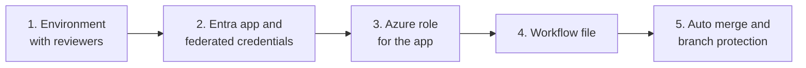

# Set up with GitHub Actions

This sets up a repository so every pull request that touches Bicep is planned, reviewed and deployed. It takes about 15 minutes.



## 1. Create an environment with required reviewers

1. In the repository, go to **Settings → Environments → New environment**, for example `production`.
2. Under **Deployment protection rules**, tick **Required reviewers** and add the people or teams who approve deployments.
3. Save the protection rules.

The deploy job targets this environment, so it waits for one of those reviewers.

## 2. Let the repository sign in to Azure

[Register an application](https://learn.microsoft.com/entra/identity-platform/quickstart-register-app) in Microsoft Entra ID, then choose how it signs in.

**OpenID Connect (recommended).** No secret is stored. Add two [federated credentials](https://learn.microsoft.com/azure/developer/github/connect-from-azure-openid-connect) to the application, both with the scenario **GitHub Actions deploying Azure resources**:

| Credential | Entity type | Used by |
|---|---|---|
| 1 | **Pull request** | the plan job |
| 2 | **Environment**: the environment from step 1 | the deploy job |

The subject must match the claim GitHub sends. Repositories created recently use the immutable form `repo:<owner>@<owner-id>/<repo>@<repo-id>:pull_request` instead of `repo:<owner>/<repo>:pull_request`. To see which form a repository uses, run:

```bash
gh api repos/<owner>/<repo>/actions/oidc/customization/sub
```

If the sign-in fails with `AADSTS700213: No matching federated identity record found`, the error message shows the subject that was sent.

An application holds at most 20 federated credentials. Use a separate application for each repository; that is also the safer choice.

**Client secret.** [Add a client secret](https://learn.microsoft.com/entra/identity-platform/quickstart-register-app#add-a-client-secret), store it as the repository secret `AZURE_CLIENT_SECRET`, and pass it as `azure_client_secret` to both actions. Replace it before it expires.

## 3. Give the application an Azure role

[Assign a role](https://learn.microsoft.com/azure/role-based-access-control/role-assignments-steps) at the deployment scope that lets it deploy what the template contains:

- **Contributor** is enough for most resources.
- **Owner**, or **Contributor** plus **Role Based Access Control Administrator**, is needed when the template creates role assignments.
- A deployment stack with deny settings needs `Microsoft.Resources/deploymentStacks/manageDenySetting/action`. Owner and **Azure Deployment Stack Owner** have it; Contributor does not.

The plan job only reads from Azure, but it uses the same identity, because `validate` and `what-if` need the permissions of a real deployment.

A new role assignment can take a while to become visible. The actions wait for it, for up to `subscription_wait_minutes`.

## 4. Add the workflow

Copy an example into `.github/workflows/` and fill in the IDs:

| Example | Use it for |
|---|---|
| [`recommended.yml`](./examples/github/recommended.yml) | **Start here.** A subscription deployment as a stack, with PSRule, the cost estimate and a snapshot. |
| [`minimal.yml`](./examples/github/minimal.yml) | The fewest settings: a standard deployment to a resource group. |
| [`multi-environment.yml`](./examples/github/multi-environment.yml) | Test, then production, from one pull request. |
| [`auto-approve-safe-plans.yml`](./examples/github/auto-approve-safe-plans.yml) | Skips the manual approval when the plan only creates or modifies; anything else waits for a reviewer. |

Then commit:

- the template and its `.bicepparam` file;
- a [`ps-rule.yaml`](../ps-rule.yaml) options file, if you set `rule_option`;
- a Bicep snapshot. Run `bicep snapshot main.bicepparam --mode overwrite ...`, or commit without one; the first plan comment shows the exact command.

The workflow must check out the repository before it calls the actions, and the jobs need these permissions:

| Job | Permissions |
|---|---|
| plan | `contents: read`, `id-token: write`, `pull-requests: write` |
| deploy | `contents: write` (for auto merge), `id-token: write`, `pull-requests: write` |

Pin the actions to a release tag, for example `@v1`. See the [tags](https://github.com/innofactororg/bicep-action/tags).

## 5. Auto merge (optional)

To merge the pull request automatically after a successful deployment:

1. In **Settings → General**, enable **Allow auto-merge**. Also enable **Automatically delete head branches** if you want the branch removed.
2. Add [branch protection](#6-branch-protection) with at least one required status check. Without one, GitHub refuses auto merge ("Pull request is in unstable status"), and the deploy job fails after a successful deployment.

To turn it off, set `auto_merge` to an empty value.

## 6. Branch protection

Protect the default branch under **Settings → Branches** (or with a ruleset):

- Require a pull request before merging:
  - require approvals;
  - dismiss stale approvals when new commits are pushed;
  - require approval of the most recent reviewable push.
- Require status checks to pass, and require branches to be up to date. Add **🏃 Deploy**, or your deploy job's name, as a required check.
- Require conversation resolution.
- Require linear history.
- Require deployments to succeed, and select the environment.

Together these make sure nothing changes between the approval and the merge, and that the merged code is the code that was planned and deployed.

## Next

- [Configuration reference](./configuration.md)
- [How it works](./how-it-works.md)
- [Troubleshooting](./troubleshooting.md)
